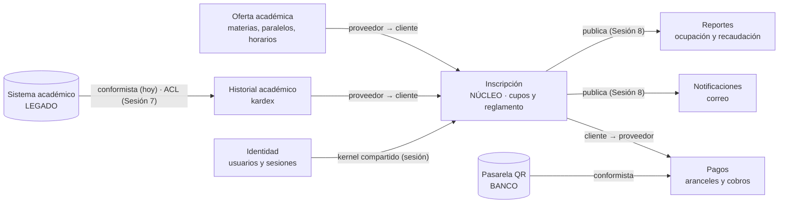

# Mapa de contextos de Cupo · Sesión 5

Un **contexto delimitado** (bounded context) es una parte del sistema donde las palabras tienen un significado preciso y único. El mapa muestra los contextos y cómo se relacionan.

| Contexto | Tipo | Responsable de | Hoy en el código |
|---|---|---|---|
| **Inscripción** | núcleo (core) | Las reglas del reglamento y los cupos. Es lo que hace único a Cupo. | `src/inscripciones/` · `dominio/` |
| **Oferta académica** | de soporte | Qué materias y paralelos se ofrecen en la gestión. | `src/oferta/` |
| **Pagos** | genérico | Calcular aranceles y cobrar. | `src/pagos/`, `aranceles.ts` |
| **Historial académico** | de soporte | Traducir el kardex del legado. | `src/kardex/`, `kardex-legado.client.ts` |
| **Identidad** | genérico | Quién es el usuario y qué rol tiene. | `src/auth/`, `src/usuarios/` |
| **Notificaciones** | genérico | Avisar al estudiante. | `src/notificaciones/` |
| **Reportes** | de soporte | Ocupación y recaudación para la Dirección. | `src/reportes/` |

## Relaciones

- **Proveedor → cliente** (customer/supplier): Oferta provee los paralelos; Inscripción los consume y decide los cupos.
- **Conformista**: hoy Cupo acepta el modelo del legado tal cual (`SIS111`, `APROB`, `CONV`). Por eso el modelo ajeno se filtra. En la Sesión 7 se reemplaza por una **capa anticorrupción** (ACL).
- **Publicar eventos**: en la Sesión 8, Inscripción publica `InscripcionConfirmada` y Notificaciones y Reportes reaccionan.

## Lo que el mapa deja ver

- El ciclo de módulos `inscripciones ⇄ oferta` (D4 del inventario) es una frontera mal trazada: Oferta cuenta inscritos leyendo el repositorio de Inscripción. En la Sesión 7, cada contexto expone solo una interfaz pública.
- Hay **dos** clientes del legado (uno en `kardex/` y otro en `inscripciones/`): el contexto Historial académico todavía no tiene una sola puerta.
